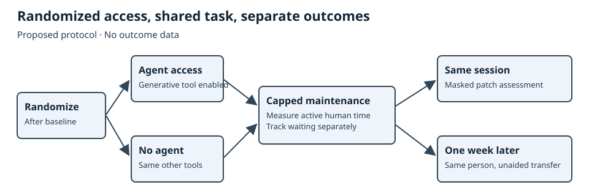

# The Junior’s Curve: How Coding Agents Change the Work of First-Year Developers

*Proposed study protocol. No participants recruited, data collected, or results reported.*

## Abstract

An early software job produces code and gives newcomers practice diagnosing failures, making design decisions, and verifying fixes. Coding agents may change how a first-year developer spends time without changing how much the developer learns, or change learning without changing task completion. We propose a parallel randomized study of agent access for developers in their first year of professional software work. Participants maintain unfamiliar code in a controlled repository. We measure active human minutes in six phases, judge the delivered change independently, and assess the same participant on a different bug one week later without an agent. The experiment estimates the effect of access under present-day conditions. Job advertisements and historical employment records answer different questions.

## Research question and design

Offering an agent might reduce implementation time while leaving more work in planning or checking. But the agent might shorten those phases too, or move part of the review to a teammate. We ask which phases gain or lose **absolute human minutes**, whether the patch works, and whether the newcomer can diagnose a related failure later. Less implementation time and more Check time are directional hypotheses, not required outcomes. A phase’s share can rise while its minutes fall.

Recruit developers within twelve months of starting their first professional software development role. Use prior paid professional software development experience to screen tenure, not age or graduation year. Before recruitment, specify how part-time roles, internships, co-ops, contracting and multiple employers will count, and keep dates granular enough to audit eligibility without collecting unnecessary identifiers. Any student or recent-graduate feasibility cohort would be reported separately. Before assignment, measure familiarity with the stack, prior agent use, and unaided baseline diagnosis and test-design performance. Randomize individuals 1:1 within prespecified task and baseline strata to an agent-enabled environment or the same environment without generative assistance. Use the same editor, documentation, requirements, acceptance criteria and time cap. Record the agent version, permissions, use and deviations. Estimate the effect of **offering access**, whether or not a participant uses it. Analyze actual usage descriptively rather than treating self-selected usage as randomized.

Use matched maintenance tickets in seeded, non-employer repositories. Pilot comparable task variants and balance them across groups. One ticket asks participants to repair duplicate notifications after a delivery retry without blocking legitimate repeats. Provide a standardized clarifier and a simulated handoff and release check in both arms. This makes coordination and operations observable without requiring production access. It does not reproduce the effort of a senior colleague’s review or a live incident. Separate parallel groups avoid participants bringing an agent-generated solution into a later control session.

| Study stage | What happens | Evidence produced |
|---|---|---|
| Baseline | Confirm tenure and run a short unaided task | Baseline skill and familiarity |
| Random assignment | Authorize access or disable generative assistance | Assigned condition and adherence |
| Capped maintenance ticket | Trace, change and verify a seeded failure; run a release check and make a handoff | Six-phase human timeline; separate elapsed and agent measures |
| Independent patch assessment | Run hidden checks and apply the same review rubric, masked to assignment where feasible | Task completion and patch quality |
| One week later | Same person, different bug, no agent in either arm | Delayed unaided transfer |

*Figure 1. Proposed study workflow. Both conditions follow the same schedule. The patch and delayed transfer are different outcomes; the latter is not a second developer’s handoff test.*

## Measuring the six phases

Use the [parent framework](https://github.com/nikbearbrown/a-new-shape-for-work) and align the software protocol with the [posting codebook](https://github.com/nikbearbrown/the-juniors-curve/blob/88518bccecfab0939175efdd628d06f80f07e0e7/methods/entry-level-stem.md), without equating the units. Split the [earlier software pilot’s](https://github.com/nikbearbrown/the-juniors-curve/blob/88518bccecfab0939175efdd628d06f80f07e0e7/methods/phase-measurement.md) Specify category between Understand and Plan. Design normally belongs in Plan; Build, Verify and Operate typically become Produce, Check and Sustain. Retain Other/unclear explicitly.

| Phase | Duplicate-notification example |
|---|---|
| Understand | Trace retries and read logs to explain why the same event can send twice. |
| Plan | Decide where deduplication belongs and specify when a second notification is legitimate. |
| Produce | Edit the code or direct an agent to draft a patch. |
| Check | Run a retry case against a stated expectation; confirm distinct messages still send. |
| Sustain | Execute a simulated rollout check, monitor the signal and identify the rollback trigger. |
| Coordinate | Confirm the requirement with the clarifier or give the reviewer a handoff with evidence and a known limitation. |

Code the purpose of each timestamped interval, not the app or action: a reproduction used to learn an unfamiliar flow is Understand; a reproduction used to check an expected failure is Check. Mark Ramp separately when the person is getting up to speed. Record participant waiting and agent execution on separate timelines. An agent may run while the developer reads, so those intervals cannot be summed as human work. Mark an offered phase with no observed activity as zero, distinguish missing telemetry, and mark a phase the task cannot elicit as not applicable. None implies an absence of that phase in the actual job.

Blind independent coders to the hypotheses where practical; tool use may reveal condition. Train on a calibration set that includes mixed prompts, reading while an agent runs, and agent-authored tests. Freeze primary-purpose and segmentation rules, then independently double-code a holdout sample balanced across arms and task variants. Report pre-reconciliation phase confusions and agreement in participant-level minutes alongside missing or unclear time by arm. Record instrumentation gaps rather than inferring that inactivity means reflection or learning. Patch reviewers see de-identified artifacts and fixed acceptance tests, not phase logs.

## Outcomes and analysis

Use active Produce and Check minutes through the cap as proposed co-primary outcomes. Prespecify meaningful effect sizes and an adjustment, such as Holm, for phase-specific tests. A directional shift from Produce to Check requires effects in both hypothesized directions; an isolated effect is not evidence of that joint shift. Retain unfinished tasks: these are observed minutes from a common start through completion or cap, not imputed minutes to a completed fix. Early completion can shorten the opportunity for every phase; report completion times and quality alongside phase minutes, and do not restrict the primary comparison to completers. Timestamp voluntary stops separately from completions, and distinguish observed stopping from lost telemetry. Report the other phases, total active and elapsed minutes, completion, patch quality, and phase shares with their active-time denominator, including Other/unclear. Report treatment-minus-control differences with intervals at the participant level; if participants do multiple tickets, account for clustering within person. Give telemetry coverage by arm and predefine missingness sensitivity checks. Size the main study from pilot variability and a meaningful difference in minutes, not from example shares.

Assess delayed transfer separately as a prespecified secondary outcome, reporting effect estimates and uncertainty rather than treating it as a powered confirmatory test. A week later, give the same person a bug in a different small service with altered symptoms but an underlying retry or idempotency problem. Both groups work without agents or their original solution and receive equal reference materials. Mask scorers to initial condition and use an anchored rubric for explaining the failure, locating its cause, and proposing a test that would expose it. Report follow-up attendance by arm and sensitivity to differential attrition; use baseline diagnosis skill as a prespecified precision covariate and distinguish the delay-period exposure survey from the outcome. Do not adjust the primary access effect for practice that happened after assignment. Retain the same task window and use non-overlapping surface details so recall of the first fix does not suffice. Minutes and delayed scores cannot alone establish that any particular phase caused learning.

## What the study can establish

[Shen and Tamkin](https://arxiv.org/html/2601.20245v2) measured comprehension immediately after an unfamiliar-library task. Twenty-nine of their 52 participants reported seven or more years of coding; coding experience does not establish professional tenure. Their setting motivates a learning measure, not a first-year or delayed-transfer estimate. In [Borg et al.](https://doi.org/10.1007/s10664-026-10889-1), 75 people in the randomized second phase evolved another person’s solution without AI. The study detected no clear overall difference on that handoff task and fell short of its intended sample. It addresses the maintainability of the artifact, whereas our follow-up addresses the original developer’s retained understanding.

The experiment can estimate the effect of access for the sampled developers, tools and tickets. It cannot estimate the workweek mix, hiring, or how first-year work changed historically. Advertised duties are descriptions, not minutes or hires; comparing them with this design can align concepts, not establish a common denominator. A field study would need comparable longitudinal measures or a credible rollout design that addresses changes in staffing, tasks and policy. A present-day control is not a pre-agent workforce.

Before recruitment, seek institutional human-subjects guidance and any required approvals. Specify consent, logging limits, retention and access controls; exclude employer code and real credentials. Participation and scores must not affect employment or grades. The first deliverable is a tested synthetic ticket and a phase rubric, not a plotted curve.
